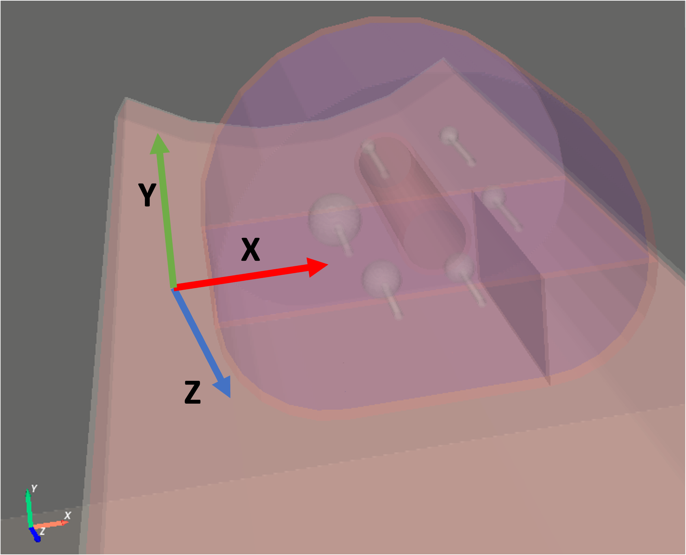
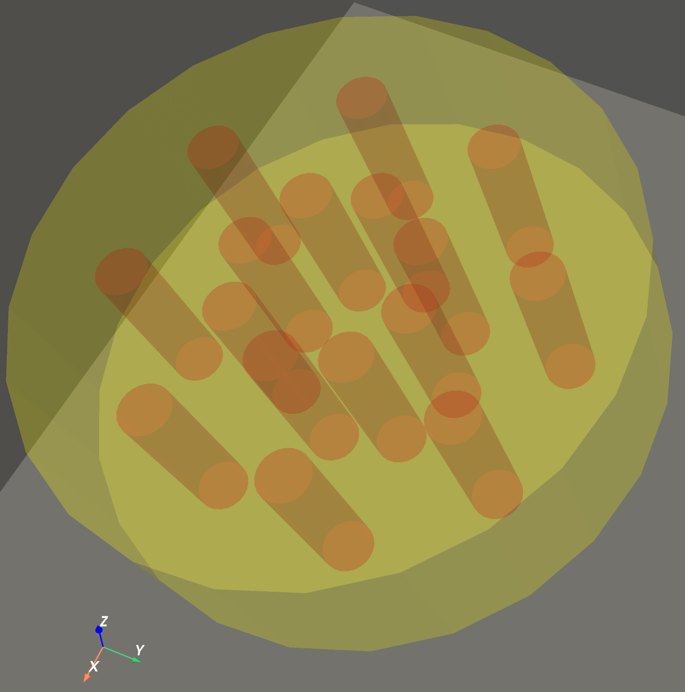

Phantoms
========

Phantom: IEC 6 spheres NEMA phantom
-----------------------------------

An analytical model of the 6 spheres IEC NEMA phantom is provided. It can be used as follows:

.. code-block:: python

    import opengate as gate
    import opengate.contrib.phantoms.nemaiec as gate_iec

    sim = gate.Simulation()
    iec_phantom = gate_iec.add_iec_phantom(sim, 'iec_phantom')
    activities = [3 * BqmL, 4 * BqmL, 5 * BqmL, 6 * BqmL, 9 * BqmL, 12 * BqmL]
    iec_source = gate_iec.add_spheres_sources(sim, 'iec_phantom', 'iec_source', 'all', activities)
    iec_bg_source = gate_iec.add_background_source(sim, 'iec_phantom', 'iec_bg_source', 0.1 * BqmL)

The rotation should be adapted according to your need. The layout of the 6 spheres can be changed with the parameters `sphere_starting_angle` (angle of the first sphere, default 180 deg, the 37 mm sphere) and `toggle_sphere_order` (reverse order, the first sphere is then the 10 mm one) of the `add_iec_phantom` command, to match a given physical phantom.

Materials: the body and the shells of the spheres are ``IEC_PLASTIC`` (PMMA, 1.18 g/cm3), the interior and the spheres are ``G4_WATER``, and the central (lung) insert is ``IEC_LUNG``: polystyrene beads and water, 0.30 g/cm3 (``gate_iec.iec_lung``). Up to opengate 10.1.1 (before issue #1211), the insert was ``G4_LUNG_ICRP`` (lung tissue, 1.04 g/cm3); to reproduce older simulations, set the material of the volume ``<name>_center_cylinder_hole`` to ``G4_LUNG_ICRP``.

Two versions of the phantom are available, selected with the parameter `version` of `add_iec_phantom`, and named after their total (outer) length:

=========== ============ ==================== =============== ==================
version     total length top and bottom walls interior length sphere centres (z)
=========== ============ ==================== =============== ==================
``iec_214`` 214 mm       10 mm                194 mm          +27 mm
``iec_220`` 220 mm       3 mm                 214 mm          +37 mm
=========== ============ ==================== =============== ==================

``iec_214`` is the default (GATE 10). ``iec_220`` corresponds to the GATE 9 macro (GateContrib ``NEMA_IEC_2001.mac``) and can be used to reproduce GATE 9 simulations. In both versions, the sphere centres are 70 mm below the inside of the lid, as specified by NEMA, and the z positions above are relative to the centre of the phantom.

.. code-block:: python

    iec_phantom = gate_iec.add_iec_phantom(sim, 'iec_phantom', version='iec_220')

The functions that return the default sphere centres also take this parameter, e.g. ``gate_iec.get_default_sphere_centers_and_volumes(version='iec_220')``.

Examples can be found in `test015 <https://github.com/OpenGATE/opengate/blob/master/opengate/tests/src/geometry/test015_iec_phantom_1.py>`_ (and others).

Phantom: cylinder phantom for PET NECR
--------------------------------------

An analytical model of the simple NECR phantom (cylinder and linear source) is provided. It can be used as follows:

.. code-block:: python

    import opengate as gate
    import opengate.contrib.phantoms.necr as gate_necr

    sim = gate.Simulation()
    necr_phantom = gate_necr.add_necr_phantom(sim, 'necr_phantom')
    necr_source = gate_necr.add_necr_source(sim, 'necr_phantom')
    necr_source.activity = 1000 * Bq

Example can be found in `test049 <https://github.com/OpenGATE/opengate/blob/master/opengate/tests/src/actors/test049_pet_digit_blurring_v1.py>`_ (and others).

Phantom: Gammex 467
--------------------------------------

An analytical model of the Gammex 467 phantom is provided. It can be used as follows:

.. code-block:: python

    import opengate as gate
    import opengate.contrib.phantoms.gammex467 as gammex467_phantom

    sim = gate.Simulation()
    gammex467_phantom = gammex467.add_gammex467_phantom(sim)

