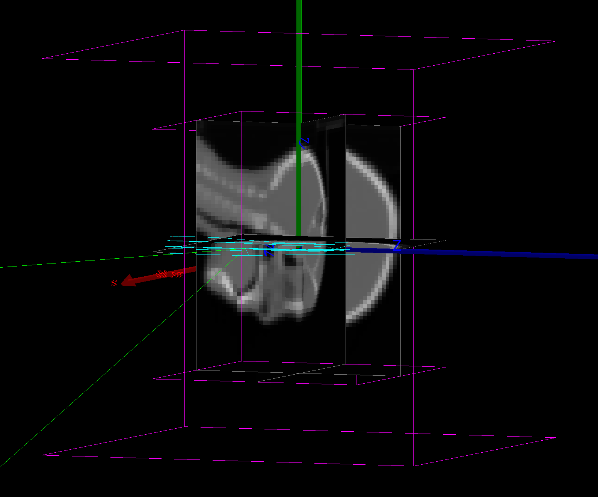
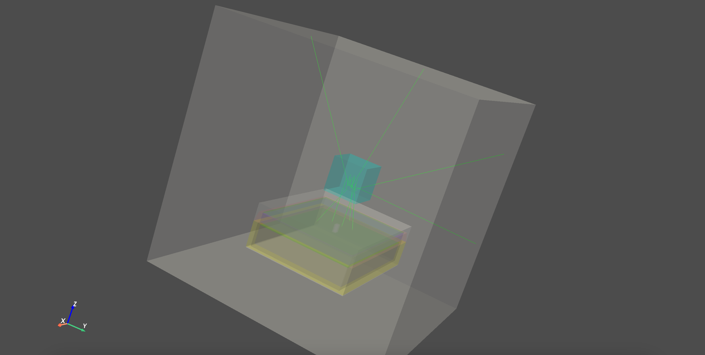
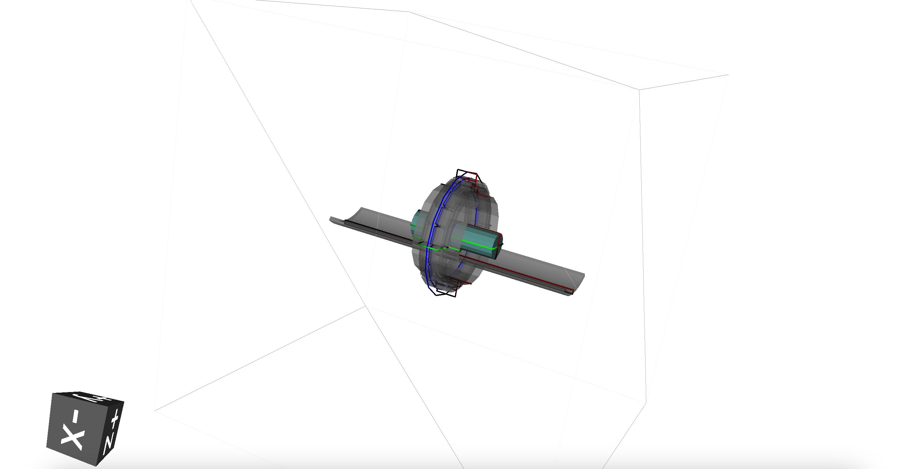

Details: Simulation object
==========================

You can configure the general behavior of your simulation via the parameters of the :class:`opengate.managers.Simulation` object.

Random Number Generator
------------------------

The random number generator used by Geant4 can be set with ``sim.random_engine = "MersenneTwister"``. The default one is "MixMaxRng" and not "MersenneTwister" because it is recommended by Geant4 for multithreading.

You can set the seed of the random number generator with ``sim.random_seed = 123456789`` to any number. Fixing the seed means that the results will be identical  if you run the same simulation twice, which can be useful for testing. There are some exceptions to that behavior, for example when using PyTorch-based GAN. By default, it is set to "auto", which means that the seed is randomly chosen.

Run and timing
--------------

The simulation can be split into several runs, each of them with a given time duration. This is used for example for simulations with a dynamic geometry, e.g. a rotating gantry or a breathing patient. Gaps between the intervals are allowed. By default, the simulation has only one run with a duration of 1 second.

See also :doc:`user_guide_dynamic_parametrisations` for the user-facing dynamic
parametrisation interface used by moving geometries, dynamic image volumes, and
dynamic voxel sources.

Splitting a simulation into multiple runs is faster than executing a simulation multiple times because Geant4 is initialized only once at the beginning.

In the following example, we define 3 runs, the first has a duration of half a second and starts at 0, the 2nd run goes from 0.5 to 1 second. The 3rd run starts later at 1.5 seconds and lasts 1 second.

.. code-block:: python

   sim.run_timing_intervals = [
       [0, 0.5 * sec],
       [0.5 * sec, 1.0 * sec],
       # Watch out: there is (on purpose) a 'hole' in the timeline
       [1.5 * sec, 2.5 * sec],
   ]

Verbosity
----------

The **verbosity**, i.e., the messages printed on the screen, are controlled via various parameters:

- .. autoproperty:: opengate.Simulation.verbose_level
- .. autoproperty:: opengate.Simulation.running_verbose_level
- .. autoproperty:: opengate.Simulation.g4_verbose
- .. autoproperty:: opengate.Simulation.g4_verbose_level
- .. autoproperty:: opengate.Simulation.g4_verbose_level_tracking
- .. autoproperty:: opengate.Simulation.visu_verbose

Visualisation
-------------

You can enable **visualisation** with ``sim.visu = True``.

GATE 10 can visualize your simulation is different ways, namely using the native Geant4 Qt-based visualization, or via vrml or gdml files. You can select the type of visualization with

.. autoproperty:: opengate.Simulation.visu_type

To check which visualisation types work on your computer, run:

.. code-block:: bash

    opengate_check_visu

It writes a VRML and a GDML file, starts a Geant4 Qt session and creates the Qt OpenGL viewer, and checks that ``pyvista`` and ``pyg4ometry`` (the viewers of the vrml and gdml files) are installed. No window is opened: Qt runs offscreen. As the offscreen Qt usually has no OpenGL (on Linux), the OpenGL viewer check is then skipped. With ``opengate_check_visu --display``, the Qt checks use the real display, and a Qt window opens for a few seconds: use it to check the Qt viewer. Each check runs in its own process, so a crash is reported as a failure, with the end of its output.

Qt
^^

If you set `visu_type='qt'`, you can customize the Geant4 visualization commands with

.. autoproperty:: opengate.Simulation.visu_commands

.. note:: When the simulation contains an :class:`opengate.geometry.volumes.ImageVolume` (e.g. a CT), the Qt and VTK visualizations display the image box and its three middle slices, see `test009 <https://github.com/OpenGATE/opengate/blob/master/opengate/tests/src/geometry/test009_voxels_visu.py>`_ (and others). The intensity window of the slices is set with the ``visu_window`` parameter of the image volume, see :ref:`image-volume-visualisation`. The voxels themselves are never drawn, which keeps the viewer fast even with large images. With the VRML and GDML visualizations, the image volume is displayed as a plain box. The slices need opengate_core compiled with Qt against a Geant4 build tree: this is the case of the pip wheels for macOS and Linux (the Windows wheels have no Qt visualization); with a source build against an installed Geant4, the image is displayed as a plain box (see the cmake output).

VRML
^^^^

You can choose VRML visualization with ``sim.visu_type = "vrml"``. Opengate uses ``pyvista`` for the GUI, so you need to install it with:

``pip install pyvista``

Alternatively, if you want to use an external VRML viewer, you can save a VRML file with ``sim.visu_type = "vrml_file_only"``. In such cases, the GUI is not opened, and you do not need ``pyvista``. In both cases, you need to set ``sim.visu_filename = "geant4VisuFile.wrl"`` to save the VRML file.

If you want to personalize the ``pyvista`` GUI, you can set ``sim.visu_type = "vrml_file_only"`` and execute your own code in your Python script. You can find an example in `test004_simple_visu_vrml <https://github.com/OpenGATE/opengate/blob/master/opengate/tests/src/others/test004_simple_visu_vrml.py>`_ .

GDML
^^^^

With GDML visualization, you can only view the geometry, not the paths of the particles. It is enabled with ``sim.visu_type = "gdml"``. GDML visualization needs to be enabled in Geant4 with ``GEANT4_USE_GDML=ON`` during the compilation, but you need to have ``xerces-c`` available on your computer (install it with yum, brew, or apt-get, ...).

Opengate uses ``pyg4ometry`` for the GUI, so you need to install it with:

``pip install pyg4ometry``

``pyg4ometry`` uses opencascade libraries, so install opencascade with your package manager. If you want to use an external GDML viewer, you can save the visualization to a GDML file with ``sim.visu_type = "gdml_file_only"``. In such cases, the GUI is not open, and you do not need ``pyg4ometry``. In both cases, you need to set ``sim.visu_filename = "geant4VisuFile.gdml"`` to save the GDML file. You can find an example in `test004_simple_visu_gdml <https://github.com/OpenGATE/opengate/blob/master/opengate/tests/src/others/test004_simple_visu_gdml.py>`_ .

VTK (optional)
^^^^^^^^^^^^^^^

A VTK visualisation is available as an opt-in alternative to the Geant4 viewers (``visu_type = "vtk"``). It is **not** installed by default and it is **not** the default viewer: VTK is a heavy dependency, so it is an optional extra.

.. code-block:: bash

   pip install vtk
   # or, with the optional dependency of opengate declared in pyproject.toml:
   pip install 'opengate[vtk]'

If you select ``visu_type = "vtk"`` without VTK, the simulation stops with that install command in the message (it does not fail silently).

.. code-block:: python

   sim = gate.Simulation()
   sim.visu = True
   sim.visu_type = "vtk"
   sim.visu_backend = "auto"  # cuda, vulkan, gpu or cpu
   # optional: save an image and render without a window (cluster, CI)
   sim.visu_screenshot = "scene.png"

The VTK viewer renders the scene GATE already exports through the VRML scene handler: the volumes with their colours, the accumulated trajectories, and (like the Qt viewer, unlike the VRML and GDML viewers) the three middle slices of each image volume, with the intensity window of ``visu_window``. The orientation axes are those of the Qt viewer. As with the VRML visualization, ``visu_filename`` is only needed to keep the ``.wrl`` file (it is temporary otherwise); the slices are handed to the viewer through a ``.wrl.slices.npz`` sidecar next to it.

The graphics backend is chosen by VTK, i.e. the best one available on the machine; opengate only reports and (optionally) pins it:

``cuda``
    render on the NVIDIA proprietary driver, when an NVIDIA card is present (a device choice, not a rendering API)
``vulkan``
    ``vtkWebGPURenderWindow`` with the Vulkan backend (needs a VTK built with RenderingWebGPU)
``gpu``
    the default VTK backend on whatever GPU is present
``cpu``
    software rendering (OSMesa / Mesa llvmpipe, Linux only in practice)

``auto`` (the default) walks that ladder, first success wins, and logs the decision once, naming the device and why the previous rungs were skipped, e.g. ``visu backend: gpu -> opengl2 on AMD Radeon Pro 560X OpenGL Engine (skipped: cuda: no NVIDIA device found ...)``. An explicit ``visu_backend`` never degrades silently: it raises when it cannot be used. ``OPENGATE_VISU_BACKEND`` overrides ``auto`` from the environment. The probe runs in a child process, so a graphics driver that aborts only loses that rung and never a simulation that has already run. ``opengate_visu --probe`` prints the ladder of a machine.

The same viewer is available from the command line on an exported file:

.. code-block:: bash

   opengate_visu --vtk --input scene.wrl --backend auto --screenshot scene.png
   opengate_visu --probe

Benchmark
^^^^^^^^^

``opengate_visu_benchmark`` measures every driver on the same scene, each viewer in its own process. ``opengate_visu_benchmark --generate DIR --with-image`` builds the demo scene (a water box, a ring of 12 spheres and a CT-like image volume), exports it and prints the table:

``vrml``
    Geant4 VRML2FILE export + the pyvista viewer (the default today)
``gdml``
    Geant4 GDML export + the pyg4ometry viewer
``vtk``
    Geant4 VRML2FILE export + the VTK driver
``qt``
    the Geant4 Qt viewer (a GUI event loop: reported, never timed)

Measured on an Intel Mac (AMD Radeon Pro 560X, VTK 9.7.1, pyvista 0.49.2, 13 volumes, 6930 triangles, 30 frames):

===========  ========  ========  ==========  =============  ===========
driver       sim+exp.  load      first frame frame median   peak RSS
===========  ========  ========  ==========  =============  ===========
vtk          19.2 s    3.9 s     654 ms      2.2 ms         289 MB
pyvista      5.9 s     1.5 s     200 ms      3.7 ms         284 MB
===========  ========  ========  ==========  =============  ===========

What this says, and what it does not:

* Once the scene is loaded, the VTK driver and pyvista render at the same speed (both are VTK: pyvista is a wrapper over it), so there is no speed argument for or against the VTK driver -- its value is that it removes the fixed-function OpenGL code of ``GateImageBox.cpp`` (issue #1040) and gives us the image slices in a maintained rendering toolkit.
* The VTK driver renders **more** than pyvista here: it also draws the three image slices and their outlines (28 props against 22), which is why its load time is higher.
* The ``sim+export`` column of the VTK row includes the one-off backend probe (a child process importing opengate and VTK) and the first shader compilation, i.e. the cold start of VTK in a fresh process. It is paid once per process.
* Not measured on that machine, and why: the GDML driver needs an ``opengate_core`` compiled with ``USE_GDML`` (it was not), ``pyg4ometry`` needs opencascade/gmp, and the Qt driver has no offscreen mode nor any way to be driven without a user. The benchmark reports those as *not available*, with the reason, rather than skipping them silently.

This is phase 1 of the plan in discussion `#1228 <https://github.com/OpenGATE/opengate/discussions/1228>`_: no C++ change, VTK optional and opt-in. Removing the OpenGL slice code from ``GateImageBox.cpp`` (phase 2) and a native Geant4 VTK driver (phase 3, blocked upstream on Qt6/VTK) are not part of it.

Multithreading
--------------

.. autoproperty:: opengate.Simulation.number_of_threads

.. warning::

   The speedup is not optimal in all situations. First, it takes time to start a new thread, so if the simulation is short, MT does not bring any speedup. Second, if the simulation contains several runs (e.g., for moving volumes), the master thread will wait for all threads to terminate the run before starting another one. This synchronization takes time and impacts the speedup.

However, for other cases, MT is very efficient and brings almost linear speedups, at least for a "low" number of threads (we tested it with 8 threads on dose computation, leading to almost x8 time gain).

Multiprocessing (advanced use)
------------------------------

The Geant4 kernel can only be executed once per process and cannot be reused in the same process. Therefore, you can (normally) not call `sim.run()` twice in the same script.

This could be a problem in certain scenarios, e.g. when using interactive Python terminal (ipython) or Python notebooks, or when you would need to run a simulation multiple times from a single script. To overcome this limitation, the simulation can be executed in a separate process (different from the one where your script is running). All you need to do is to set `start_new_process=True` when running the simulation:

.. code-block:: python

   sim.run(start_new_process=True)

When this option is used, the Geant4 engine will be created and run in a separate process, which will be terminated after the simulation is finished. The output of the simulation will be copied back to the main process that called the ``run()`` method. This allows for the use of Gate in Python Notebooks, as long as this option is not forgotten.

Progress Hook
-------------

You can attach a progress reporting hook function to monitor the progress of a running simulation at periodic intervals.

Standard Use with `progress_status`
^^^^^^^^^^^^^^^^^^^^^^^^^^^^^^^^^^^

The simplest and standard way to monitor simulation progress is using the built-in helper `gate.progress_status(filename)`. This periodically outputs structured simulation metrics (status, elapsed wall time, current run index, event progress percentage, simulation time progress, total and expected events) into a JSON file:

.. code-block:: python

   import opengate as gate

   status_file = "output/progress_status.json"
   sim.progress_hook = gate.progress_status(status_file)
   sim.progress_hook_interval = 0.5 * gate.g4_units.s

Advanced Use with a Custom Hook
^^^^^^^^^^^^^^^^^^^^^^^^^^^^^^^

For advanced usage, you can define a custom Python callback function and set `sim.progress_hook`. The hook accepts the simulation engine (or status string) and can optionally delegate to `gate.progress_status` while performing custom actions (such as logging to screen or sending progress notifications):

.. code-block:: python

   import opengate as gate

   status_file = "output/progress_status.json"
   status_reporter = gate.progress_status(status_file)

   def custom_hook(sim_engine, status="running"):
       # Perform progress reporting to JSON file
       data = status_reporter(sim_engine, status)

       # Custom action: print progress to console
       print(
           f"[Progress Hook] Run {data['run_index']}/{data['run_total']}, "
           f"Events: {data['events_total']}/{data['events_expected']} ({data['events_progress']}%), "
           f"Status: {status}"
       )

   sim.progress_hook = custom_hook
   sim.progress_hook_interval = 0.5 * gate.g4_units.s

User hooks
----------

TODO

.. [//]: # (For advanced usage, you can explicitly create the engine for the simulation with:)

.. [//]: # (   se = gate.SimulationEngine(sim))

.. [//]: # (   se.start_new_process = True)

.. [//]: # (   se.user_fct_after_init = my_function)

.. [//]: # (   output = se.start(True))

.. [//]: # (Here user can also define a function (``my_function`` in the above example) that will be called after the Geant4 engine is initialized, and before it starts the simulation. This function will be called in the newly created process, so all data it accesses must be serializable (Python's pickable) to be copied to the new process.)
