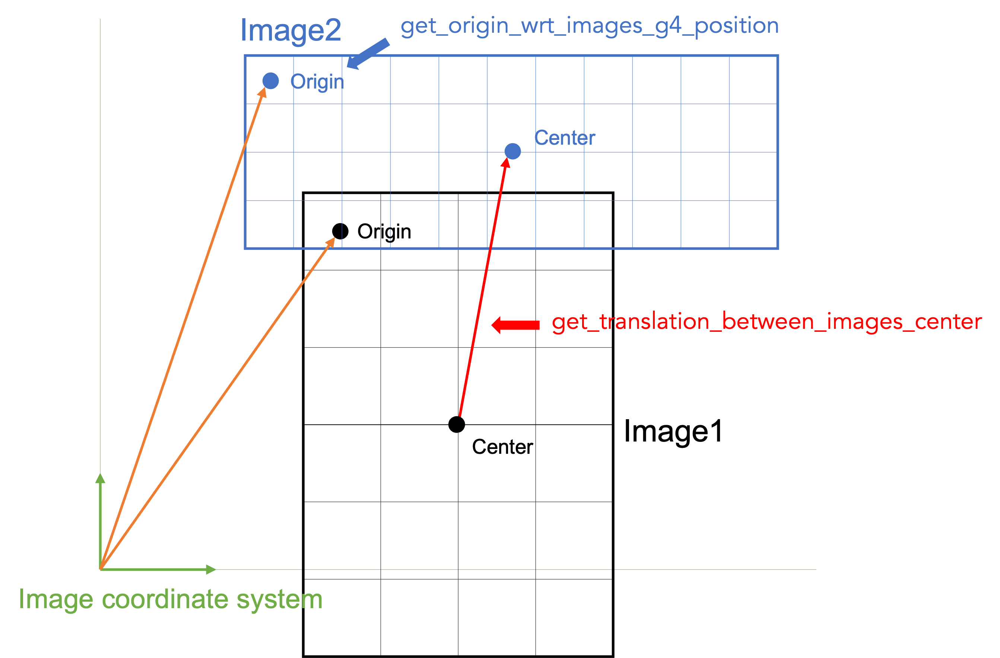

.. _source-voxel-source:

Voxelized source
================

Description
-----------

A voxelized source can be created as follows:

.. code:: python

   source = sim.add_source('VoxelSource', 'vox')
   source.particle = 'e-'
   source.activity = 4000 * Bq
   source.image = 'an_activity_image.mhd'
   source.direction.type = 'iso'
   source.energy.mono = 100 * keV
   source.attached_to = 'my_volume_name'

This code create a voxelized source. The 3D activity distribution is
read from the given image. This image is internally normalized such that
the sum of all pixels values is 1, leading to a 3D probability
distribution. Particles will be randomly located somewhere in the image
according to this probability distribution. Note that once an activity
voxel is chosen from this distribution, the location of the particle
inside the voxel is performed uniformly. In the given example, 4 kBq of
electrons of 140 keV will be generated.

The voxel image is therefore used as a relative spatial activity
distribution for position sampling. Scaling all voxel values by the same
constant does not change the total emitted activity; it leaves the same
normalized spatial distribution. The total source strength is controlled
separately by ``activity``, ``half_life``, or ``n``.

How the voxel is sampled
~~~~~~~~~~~~~~~~~~~~~~~~

The voxel of each particle is drawn with an alias table (Walker's method,
built with Vose's algorithm). The table is built once, at initialisation,
from the normalized image, and contains only the voxels with a non-zero
value. Each entry is a voxel, a probability q and a second voxel (its
"alias"). To sample, one random number selects an entry uniformly; its
fractional part is compared to q to keep the voxel of the entry or take its
alias. The cost per particle is one random number and one memory access,
whatever the size of the image.

It gives exactly the same distribution as sampling the voxels one after the
other along z, y and x, which needs three binary searches in large
cumulative tables. The difference is only in speed, about 0.06 µs per
particle instead of 0.4 to 0.9 µs for a CT-sized image. It matters when the
transport of a particle is cheap compared to its emission, or when the
images are large, for example:

- large activity images (fine voxels, whole body), or many voxel sources in
  the same simulation (one per organ, per region or per time point), that
  do not fit in the processor caches;
- particles that are tracked for only a few steps: low-energy electrons or
  beta particles that deposit their energy close to the emission point,
  simulations without a phantom, or a coarse geometry;
- variance reduction that makes the transport faster, such as the free
  flight of photons (``GammaFreeFlightActor``) or a faster navigation in
  the image volumes (see :doc:`user_guide_reference_volumes`).

When most of the time is spent tracking particles in a detailed geometry,
the gain is only a few percent.

The table needs 12 bytes per non-zero voxel. It is small for a sparse image
(a few spheres, lesions or organs); when all the voxels are non-zero it is
three times the size of the image in floats. An image
with 2^32 voxels or more is refused. A dynamic image rebuilds the table at
each change.

The activity image can also be made dynamic from one run to the next with
``source.add_dynamic_parametrisation(image=[...])``. See
:doc:`user_guide_dynamic_parametrisations`.

Like all objects, by default, the source is located according to the
coordinate system of its attached_to volume. For example, if the attached_to
volume is a box, it will be the center of the box. If it is a voxelized
volume (typically a CT image), it will the **center** of this image: the
image own coordinate system (ITK’s origin) is not considered here. If
you want to align a voxelized activity with a CT image that have the
same coordinate system you should compute the correct translation. This
is done by the function
:func:`opengate.image.get_translation_between_images_center`. See the contrib
example ``dose_rate.py``.

The direction matrix of the activity image (the rotation or flip stored
in its header) is not taken into account. To avoid silently mirroring or
rotating the activity, the simulation stops with an error if the image
direction is not the identity. The same rule applies to the image volume
the source is attached to (see :doc:`user_guide_reference_volumes`), so
that the CT and the activity image are always interpreted in the same way.

Reference
---------

.. autofunction:: opengate.image.get_translation_between_images_center
.. autoclass :: opengate.sources.voxelsources.VoxelSource
